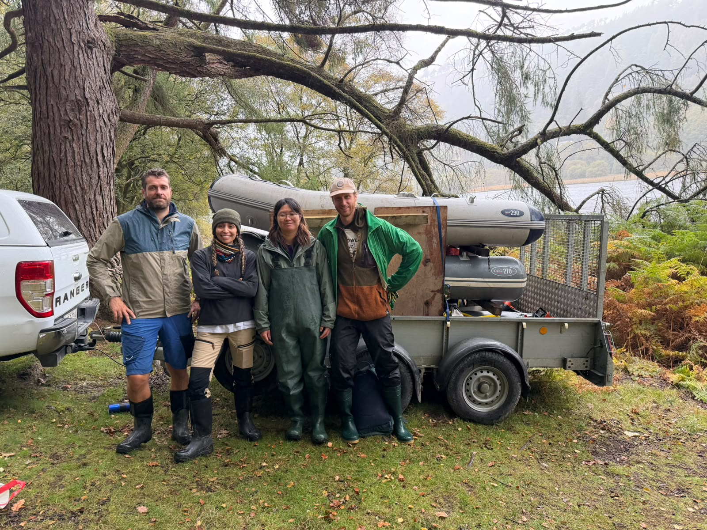

During October 2026, the MEMELAND team set out to core 9 lakes across Ireland. On the way there, Aqualate Mere (England), a key site for MEMELAND, was re-cored to a depth of 5.5 m.

::: {.callout-note}
## Key Information

📅 **Date:** 5–21 October 2026

🗺️ **Location:** Ireland
:::

## Details

In total, 9 lakes were cored across Ireland and ca. 30 m of cores were retrieved. The goal of MEMELAND is to core lakes in pairs: one lake next to a so-called high-status site, i.e., a site associated with a rich history and high anthropogenic impact on the local ecosystem, and one site that functions as a background, with limited human impact. By pairing these sites we can identify the human-induced change in the environmental history of an area.

In addition to coring in Ireland, the MEMELAND team revisited Aqualate Mere near Stafford, England. Aqualate Mere has been identified as a key site for the MEMELAND project, due to its rich history as well as excellent DNA preservation. However, previous attempts to core Aqualate Mere yielded only 2 m of sediments. This time, with a different coring setup, the MEMELAND team retrieved 5.5 m of sediments that should cover roughly the last 3-4 thousand years of history.

{fig-align="center" fig-alt="The MEMELAND team standing beside their coring equipment after coring Glendalough Lower Lake."}

: *The MEMELAND Team after successfully coring the last lake of the campaign, Glendalough Lower Lake. Photo by Andrew Butler (NPWS)*
