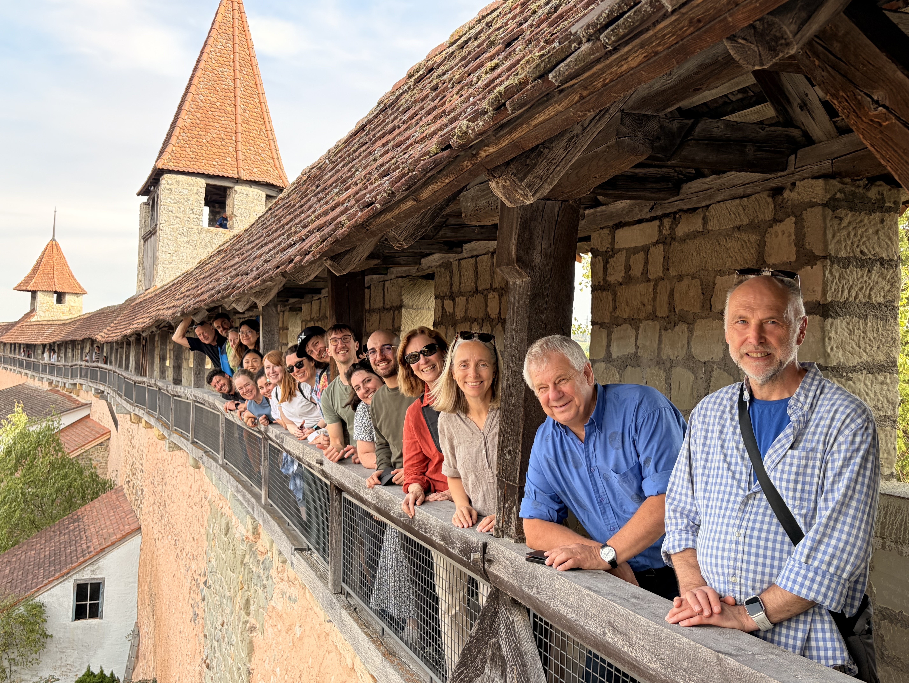

The MEMELAND team gathered for its annual meeting in the picturesque setting of Münchenwiler, near Murten, Switzerland, kindly hosted by our Swiss partner, Eawag.

::: {.callout-note}
## Key Information

📅 **Date:** 28–29 September 2026

🗺️ **Location:** Münchenwiler, Switzerland
:::

## Details

Over two inspiring and productive days, project partners travelled from across Europe, including Tromsø in northern Norway, Austria, France, Oxford and Switzerland, to share achievements, discuss challenges and plan the next stages of the project.

The programme included updates on successful field campaigns, preliminary scientific findings, budget and project progress, past and upcoming conferences, and strategic priorities. We also welcomed new team members and guest speakers, whose contributions enriched our discussions.

An important part of the meeting was dedicated to aligning the long-term scientific vision of the Principal Investigators with the research goals and career development perspectives of early-career researchers, particularly regarding publications and future opportunities.

## Background

MEMELAND in numbers - 15 months into the 84-month project:

- 75% of the planned lakes have already been cored.
- 12% of the planned sample extractions have been completed.
- 2% of the sites have yielded their first analytical results.

With priority lakes identified and a clear strategy established, MEMELAND is moving confidently into its next phase!
The meeting concluded with a visit to beautiful Lake Murten, a medieval castle and a memorable medieval-style dinner - a wonderful opportunity to strengthen collaborations beyond the meeting room.
A big thank you to our Swiss hosts and all participants for their enthusiasm, valuable contributions and inspiring discussions!

{fig-align="center" fig-alt="The MEMELAND team gathered on a covered walkway at Münchenwiler Castle."}

: *The MEMELAND team at Münchenwiler Castle. Photo: Nathalie Dubois.*
